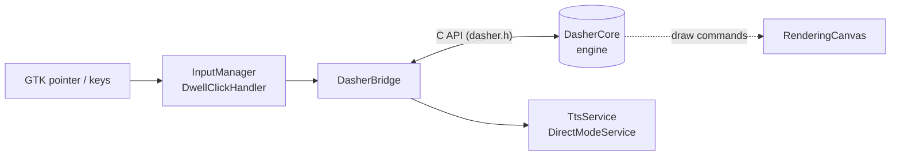

# Dasher for GTK

[](https://github.com/dasher-project/Dasher-GTK/actions/workflows/cmake-multi-platform.yml)
[](./LICENSE)

Dasher is an information-efficient text-entry interface, driven by continuous
pointing gestures. It lets you write using eye gaze, a mouse, a switch, a
joystick, or touch — designed for accessibility and augmentative communication
(AAC).

This is the **GTK** frontend, built on the shared
[DasherCore](https://github.com/dasher-project/DasherCore) engine.

> **[dasher.at](https://dasher.at)** — downloads, user docs, and live demo
> **[Feature status](https://dasher.at/status/)** — what each platform supports
> **[All repos](https://github.com/dasher-project)** — engine, frontends, design guide

## Status

> **In development** — early-stage GTK4 frontend aiming to replace Dasher 5.
> See the [feature matrix](https://dasher.at/status/) for what's implemented.

## Usage

Runtime controls live in the footer bar: the alphabet chooser, speed, a Learning
toggle, colour and font choosers, and the Speech toggle. Keyboard mode sits on the
top toolbar, and dwell-to-click is under **Preferences → Input**.

The live typing-rate readout (RFC 0012) lives under **Preferences → Output**,
showing characters per second and words per minute (e.g. `4.2 cps · 50 wpm`) in
subtle text. It is computed engine-side over a short rolling window and refreshed
about twice a second, with a **Reset** button that restarts the measurement. See
[RFC 0012](https://github.com/dasher-project/governance/pull/19).

## Install

Prebuilt **Linux** packages are attached to each [Release](../../releases):

- **Flatpak**: needs the GNOME 51 runtime
  (`flatpak install flathub org.gnome.Platform//51`), then
  `flatpak install --user Dasher.flatpak` and
  `flatpak run org.alternativeinterface.dasher`.
- **AppImage** — `chmod +x Dasher-x86_64.AppImage && ./Dasher-x86_64.AppImage`
  (self-contained).

macOS and Windows aren't packaged yet — build from source (below). How the
artifacts are produced is described under [Packaging & releases](#packaging--releases).

## Optional runtime features

Speech and Keyboard mode each depend on an external service:

- **Speech** (spoken feedback and read-aloud) needs a working text-to-speech
  engine. A from-source Linux build enables the `system` feature, which drives a
  running `speech-dispatcher` (`sudo apt install speech-dispatcher`). The Flatpak
  and AppImage ship `cloud`-only, so configure a cloud engine under
  **Preferences → Speech**. With no engine available the Speech toggle stays
  disabled. See [TTS Support](#tts-support) for how the feature set is chosen at
  build time.
- **Keyboard mode** (types Dasher's output into other applications) uses
  [`ydotool`](https://github.com/ReimuNotMoe/ydotool). Install it and run the
  `ydotoold` daemon (it needs access to `/dev/uinput`); on Debian/Ubuntu that is
  `sudo apt install ydotool`, on Arch `sudo pacman -S ydotool` **plus**
  `sudo systemctl enable --now ydotool` — the binary alone is not enough, Arch
  does not enable the service for you. Availability is checked by probing the
  daemon (a zero-length pointer move), and if injection fails mid-session the
  mode turns itself off with a message rather than dropping output silently.
  Clicking the Keyboard button (on the top toolbar) when ydotool isn't working
  opens a setup dialog with the install command for your distro and a Retry,
  instead of enabling the mode.

**Dwell to click** (hover in place to click, under **Preferences → Input**) needs
no external dependency.

## Build

### Prerequisites

| Platform | Command |
|----------|---------|
| macOS | `brew install gtk4 gtkmm4 pkg-config cmake` |
| Linux (Debian/Ubuntu) | `apt-get install build-essential libgtk-4-dev libgtkmm-4.0-dev git cmake pkg-config libspeechd-dev libclang-dev speech-dispatcher ydotool` |
| Windows | Install GTK from [GVSBuild](https://github.com/wingtk/gvsbuild/releases) to `C:\gtk`, add `C:\gtk\bin` to PATH. Requires CMake, Git, and MSVC or Clang. Use an optimized release build for binary compatibility. |

All platforms additionally require a **Rust toolchain** (`cargo`) to build the bundled
`rust-tts-wrapper`. Install it from [rustup.rs](https://rustup.rs). On Linux the
`system` TTS feature binds speech-dispatcher via bindgen, hence `libspeechd-dev`
(headers) and `libclang-dev` (for bindgen) above. The `speech-dispatcher` and
`ydotool` packages are runtime dependencies for the optional Speech and
Keyboard-mode features (see [Optional runtime features](#optional-runtime-features));
the app still builds and runs without them (the Speech toggle greys out, and
Keyboard mode offers an in-app setup helper).

### Steps

```sh
git clone --recursive https://github.com/dasher-project/Dasher-GTK.git
cd Dasher-GTK
mkdir build && cd build
cmake ..
cmake --build . --config Release --parallel
```

The runtime files are placed in `build/Dasher/`, and so is the binary, except
on Windows, where the default generator is Visual Studio. That one picks the
configuration at build time (hence `--config` above) and puts the executable in
a per-configuration subdirectory, so it lands in `build/Dasher/Release/`. The
data files are not per-configuration and stay in `build/Dasher/`, which is why
the two part company there.

#### Or use the launcher

`run.py` does the above and launches the result, on Linux, macOS and Windows
alike. It is a convenience wrapper, not a required part of the build:

```sh
python run.py                 # configure, build, then launch
python run.py --build-only    # stop after the build
python run.py --tests         # build, then run the ctest suite
python run.py --clean         # start the build directory over
```

`--build-dir` (default `build`), `--build-type` (default `Release`) and `-j/--jobs`
change where and how it builds; anything after a `--` separator is forwarded to
Dasher itself.

It checks for the system dependencies listed above and names the package to
install when one is missing, initialises the submodules if you cloned without
`--recursive`, falls back to `-DTTS_WRAPPER_FEATURES=cloud` when the
speech-dispatcher headers are absent, and launches from the right working
directory (see [Running](#running) for why that matters).

If a submodule is checked out at a commit other than the one this repository
records, the launcher says so and leaves it alone, since that is usually
somebody testing against a different engine revision. `--sync-submodules`
resets them to the recorded commits.

### Running

Dasher must be launched from the `build/Dasher/` directory so it can find its
data files. Started from anywhere else it comes up looking fine, but every
letter box is the same size, because the language model found no training text.

The binary is lowercase `dasher` on Linux and `Dasher` on macOS:

```sh
cd build/Dasher
./dasher      # './Dasher' on macOS
```

On Windows it is `Dasher.exe`, one directory deeper, and the working directory
still has to be `build/Dasher` for the data files:

```pwsh
cd build\Dasher
.\Release\Dasher.exe
```

### Running the Tests

Lightweight unit tests live in `tests/` and build alongside the app; doctest is
fetched automatically at configure time, so no extra dependency is required.
After configuring and building, run the suite with ctest:

```sh
ctest --test-dir build --output-on-failure
```

On Windows add `-C Release` (or whichever configuration you built), for the
same reason `cmake --build` needs `--config`: a multi-config generator has no
single configuration for ctest to assume, and without it the suite reports no
tests found.

CI runs these tests on every push as part of the multi-platform workflow.

The Flatpak packaging has tests of its own, in Python: see
[Testing the Flatpak packaging](#testing-the-flatpak-packaging).

### TTS Support

The `rust-tts-wrapper` submodule provides text-to-speech support. It is included
automatically when cloning with `--recursive`. CMake builds and links it if the
submodule is present.

- **macOS**: builds with `avsynth,cloud` features (no local speech-dispatcher needed)
- **Linux**: builds with `system,cloud` features (uses speech-dispatcher + cloud engines); needs `libspeechd-dev` and `libclang-dev` (see Prerequisites)
- **Windows**: builds with `sapi,cloud` features (uses the Windows SAPI engine plus cloud engines)
- All platforms need a Rust toolchain (`cargo`) on `PATH` to compile the wrapper

Override the default feature set with `-DTTS_WRAPPER_FEATURES=...` at configure
time — e.g. `-DTTS_WRAPPER_FEATURES=cloud` for a cloud-only build with no
speech-dispatcher dependency (this is what the Flatpak uses).

The feature set is decided at configure time and stored in the CMake cache, so
installing `libspeechd-dev` after a cloud-only build does not change anything
on its own: that build directory stays cloud-only until you reconfigure it from
scratch (`run.py --clean`, or delete `build/`).

### Runtime Data Files

The CMake build copies data files into `build/Dasher/Data/`. The directory layout
after building:

```
build/Dasher/
├── dasher              # executable (lowercase on Linux; `Dasher` on macOS)
├── libdasher.so        # Linux (libdasher.dylib on macOS, dasher.dll on Windows)
├── librust_tts_wrapper.so  # TTS wrapper, unless built without it
├── UIStyle.css
├── Data/
│   ├── alphabet.*.xml  # alphabet definitions
│   ├── color*.xml      # colour schemes
│   └── training*.txt   # language model training data (PPM)
├── Strings/
│   └── strings_*.json  # UI translations
└── Resources/
    └── License/
```

Dasher uses a PPM (Prediction by Partial Match) language model trained on text
files. Each alphabet definition specifies a `trainingFilename`
(e.g. `training_english_GB.txt`). Without training data, all letter boxes will be
the same size and prediction will not work. Training files are copied from
`DasherCore/Data/training/` during the build; if letters appear uniformly sized
after launch, run from `build/Dasher/` so the `"Data"` relative path resolves, and
rebuild if stale (`cmake --build build`).

### Known Issues

- **Keyboard mode** and **system Speech** aren't available in the Flatpak and
  AppImage builds. Both need host-level access the self-contained, sandboxed
  formats can't provide: `/dev/uinput` (via `ydotoold`) for `ydotool` keyboard
  injection, and `libspeechd` plus a running `speech-dispatcher` for system TTS.
  The Flatpak is `cloud`-only for speech; Keyboard mode expects a from-source or
  native install. See [Optional runtime features](#optional-runtime-features).

## Packaging & releases

Linux is distributed as **Flatpak** and **AppImage**, both built by
[`.github/workflows/publish.yml`](.github/workflows/publish.yml).

**Flatpak** — manifest: `packaging/flatpak/org.alternativeinterface.dasher.yaml`
(GNOME 51 runtime + the `rust-stable` SDK extension; builds `rust-tts-wrapper`
with `TTS_WRAPPER_FEATURES=cloud,sherpaonnx,sherpa-g2p,speaker`). The manifest
bundles the working tree via a `type: dir` source, so run `flatpak-builder`
from **outside** the repo to avoid copying its build directory into itself.
`--install-deps-from=flathub` pulls the runtime, SDK and `rust-stable`
extension at the versions the manifest declares:

```sh
flatpak remote-add --user --if-not-exists flathub https://flathub.org/repo/flathub.flatpakrepo
repo=$(pwd)
mkdir -p /tmp/dasher-fb && cd /tmp/dasher-fb
flatpak-builder --user --install --force-clean --install-deps-from=flathub build \
    "$repo/packaging/flatpak/org.alternativeinterface.dasher.yaml"
flatpak run org.alternativeinterface.dasher
```

The Flatpak build has no network access (a Flathub requirement). The crates
`rust-tts-wrapper` needs are vendored through
`packaging/flatpak/cargo-sources.json`, generated from
`packaging/flatpak/rust-tts-wrapper-Cargo.lock` (upstream commits no lock).
`packaging/flatpak/rust-tts-wrapper-Cargo.lock.commit` records the
`rust-tts-wrapper` commit the lock was generated for. When the
`rust-tts-wrapper` submodule moves, regenerate all three files; the commands
are in the manifest next to those sources.

The local speech engine is built from source as well (another Flathub
requirement). The `sherpa-onnx-sys` crate would otherwise download prebuilt
static libraries; the manifest has an `onnxruntime` module and a `sherpa-onnx`
module that build the same static libraries, and the `dasher` module points the
crate at them with `SHERPA_ONNX_LIB_DIR`. Their dependencies are checksummed
sources that the two projects' own CMake picks up from local files
(ONNX Runtime from its `mirror/` directory, sherpa-onnx from tarballs next to
its `CMakeLists.txt`). The versions are tied together: sherpa-onnx is the
release of the `sherpa-onnx-sys` version in the lock, and ONNX Runtime is the
release that sherpa-onnx is built against upstream. When `sherpa-onnx-sys`
moves, update the sherpa-onnx tag and commit, its dependency tarballs, and, if
it changed, the ONNX Runtime version with the files from that release's
`cmake/deps.txt`. The two modules take about 13 minutes on a 16-core machine
and far longer on small or emulated builders, which is why both Flatpak legs
of the publish workflow build natively (x86_64 on `ubuntu-24.04`, aarch64 on
`ubuntu-24.04-arm`): under QEMU the aarch64 leg would not finish within the job
time limit.

ONNX Runtime's source is GitHub's tarball of the release commit, pinned by
sha256, with a fork as a mirror because `microsoft/onnxruntime` returned 404
when the module was written. The comment next to that source in the manifest
explains why the mirror is a stopgap and what would make it permanent.

The licence texts of what is linked statically into the speech library are
installed under `/app/share/licenses/org.alternativeinterface.dasher/`: ONNX
Runtime's `LICENSE` and `ThirdPartyNotices.txt`, sherpa-onnx's `LICENSE`, and
the licence files of each sherpa-onnx dependency in a directory of its own.

At runtime the sandbox has network access (`--share=network`): the cloud
speech engines and the Sherpa voice downloads need it, and the opt-in
analytics upload uses it too. The build itself never has network.

The screenshot the metainfo points at is `packaging/screenshots/main-window.png`.
Flathub wants the URL to name a commit or a tag, not a branch, so it carries
the sha of the commit that added the file. That sha only stays resolvable while
the commit is reachable on GitHub: a branch that adds or replaces the
screenshot has to be merged with a merge commit (squashing or rebasing creates
new commits and leaves the sha behind), or a ref has to be kept on it. When
replacing the file, commit the image first and then point the URL at that
commit. When cutting a release, point the URL at the release tag, which is the
form that cannot go stale.

The pin-sync check (`Scripts/check-flatpak-pins.py`) fails the PR when the
recorded commit is not the submodule's commit, when that commit cannot be
fetched from upstream, when `cargo-sources.json` does not vendor exactly what
the lock names, when the sherpa-onnx source is not the tag of the locked
`sherpa-onnx-sys` version, when the ONNX Runtime version is not the one that
sherpa-onnx release pins, or when one of the dependency tarballs sherpa-onnx
needs (the eight it pins itself, plus kissfft and kaldifst, which
kaldi-native-fbank and kaldi-decoder pin) is not a source of the `sherpa-onnx`
module under the file name its CMake looks for. It compares these files with
each other and with the CMake files of sherpa-onnx and those two dependencies
at the pinned versions; it does not run cargo or build
the Flatpak, so it trusts the recorded commit (write it only when regenerating
the lock) and it does not check ONNX Runtime's own dependency list, which only
the build verifies. An upstream lookup that answers with an error (a 404, a
missing tag) fails the check. If GitHub cannot be reached at all, the checks
that need it are skipped with warnings and the last line of the output says the
run was incomplete; it still exits 0, so read that line. The offline build
itself first runs in the publish workflow on the push to `main`, not on the PR.
`--fix` moves the manifest's commit pins only and never regenerates these
files.

The check reads the manifest with a YAML parser (PyYAML, `python3-yaml`, which
the GitHub runner images ship; the workflows that run the check install it
when it is missing), so a pin is the value flatpak-builder gets, however it is
written. A `commit:` whose value is not exactly one full SHA is reported as a
missing pin: a second word, a line break, or an indented line after the SHA,
which YAML folds into the value. A manifest that is not valid YAML, or that
has the same key twice in one mapping, stops the run. Without PyYAML the
script stops and says what to install.

**AppImage** — `bash packaging/build-appimage.sh` produces `Dasher-x86_64.AppImage`.

**Cutting a release** — a `v*` tag push makes the publish workflow build both
artifacts and attach them to a new GitHub Release. Two things must be true
before you tag, or CI refuses the release:

1. **The metainfo carries this release's entry** — add a
   `<release version="…">` block at the top of `<releases>` in
   [`packaging/org.alternativeinterface.dasher.metainfo.xml`](packaging/org.alternativeinterface.dasher.metainfo.xml)
   and merge it. The validate workflow fails the tag push on a mismatch, and
   the publish workflow's release job hard-gates on the same check — a tag
   without its entry will not ship packages (that gate exists because
   v0.2.10 shipped with the check red).
2. **The DasherCore submodule is pinned at an upstream tag**, not a floating
   commit — tag DasherCore first and bump the pin.

The safe path is the helper, which enforces both plus the usual hygiene
(clean tree, on `main`, tag not taken) and refuses to tag otherwise:

```sh
Scripts/tag-release.sh --push v0.2.12 # verifies, tags, pushes
```

Freshness is enforced by the publish workflow's `tag-sanity` job, which
runs within seconds of the tag push and gates both artifact builds — a tag
that doesn't point at `origin/main`'s tip never starts a build. (The
validate workflow repeats the check as an early warning, but the
enforcement lives in publish, where failure actually blocks the release.)

If a bad tag already went out: add the missing metainfo entry, merge, then
delete and re-push the tag — validate re-runs green and the publish workflow
updates the existing release in place.

### Testing the Flatpak packaging

Three layers, from the one that runs everywhere in seconds to the one that
needs a finished build. All of it is Python with the standard library only
(3.11 or newer), plus PyYAML (`python3-yaml`), which the pin-sync check and
the tests read the manifest with.

**1. Unit tests: no build, no network.** They live in `Scripts/tests/`:

```sh
python3 -m unittest discover -s Scripts/tests -v
```

- `test_check_flatpak_pins.py` runs the pin-sync check
  (`Scripts/check-flatpak-pins.py`) against small made-up repositories and a
  faked upstream: every check with a passing case and each way it can fail,
  `--fix`, the exit codes, the `::error::` lines, what happens when GitHub
  cannot be reached, and the forms YAML has for a pin (quotes, block scalars,
  flow mappings, aliases, continuation lines, duplicate keys, CRLF), with what
  the check reads from a `commit:` value compared with a second YAML reading.
  It also runs the real manifest, lock and crate list against a faked
  upstream. `DASHER_PIN_SYNC_LIVE=1` adds one test that runs the real check
  online.
- `test_flatpak_static.py` reads the manifest, the metainfo, the desktop file
  and the workflows as they are in the tree: every source pinned by sha256 or
  commit, no `branch:`, no network during the build, the `finish-args` exactly
  the reviewed list, the from-source speech modules in place, the screenshot
  URL on a commit or tag with the size of the image in the repository, the
  newest `<release>` equal to `DASHER_GTK_FALLBACK_VERSION` in
  `CMakeLists.txt`, and the paths that this README and `CONTRIBUTING.md` name.
- `test_flatpak_smoke.py` tests the smoke test below against made-up build
  directories, so a change to it is checked without a build. That includes
  the command lines that keep the app off the desktop and the helper that
  starts it.

`.github/workflows/packaging-tests.yml` runs these on every push and pull
request; they take about ten seconds.

**2. Smoke test of a built Flatpak.**
`packaging/flatpak/tests/smoke-test.py` takes the build directory that
`flatpak-builder` leaves behind (`/tmp/dasher-fb/build` after the commands
above) and prints one `PASS`, `FAIL` or `SKIP` line per check:

```sh
packaging/flatpak/tests/smoke-test.py /tmp/dasher-fb/build
packaging/flatpak/tests/smoke-test.py /tmp/dasher-fb/build --host-checks   # also the linter, sound and /dev/input
packaging/flatpak/tests/smoke-test.py /tmp/dasher-fb/build --network       # also install the test voice
packaging/flatpak/tests/smoke-test.py /tmp/dasher-fb/build --check permissions,linkage
packaging/flatpak/tests/smoke-test.py --list
```

It checks that the permissions of the build are exactly the expected ones
(and that `--socket=session-bus` and build-time network are absent); that the
launcher, binary, libraries, desktop file, metainfo, icons and licence texts
are there and that headers, static archives and the speech build prefix are
not; that the desktop file and the metainfo validate; that every library
resolves in the Platform runtime and no search path leads out of the app; that
the speech library carries the ONNX Runtime the manifest builds, not a
prebuilt one; that the app starts, takes its bus name `org.dasher.gtk`, prints
no error and stops again; that the speech library synthesizes audible speech;
and, when asked, that the default sound device and `/dev/input` are reachable
and that `flatpak-builder-lint` reports no new error.

It needs `flatpak` with the runtime and SDK the build used.
`desktop-file-validate` and `appstreamcli` are used when present; a check
whose tool is missing is skipped and says so. What a run touches depends on
how it is started:

| Run | What it touches outside its sandboxes |
|---|---|
| default | Nothing of the desktop: no display, session bus, portal, sound server, device or network. It installs nothing, opens no window and does not write to the build directory. The app runs inside `flatpak build --readonly` on GTK's Broadway backend with a session bus of its own, with every permission of the build switched off, and writes go to a temporary directory. `flatpak build` itself asks the systemd user instance for a scope per sandbox; nothing of the session reaches the sandbox that way. |
| `--host-checks` | Adds `lint-manifest` and `lint-builddir` (`flatpak-builder-lint` uses the network; when it comes from the `org.flatpak.Builder` Flatpak it is started with `flatpak run`, which uses the session bus and portals), `audio-device` (a sandbox gets the host's sound server socket; the device is opened and closed, nothing is played) and `input-devices` (a sandbox gets the host's `/dev` and lists `/dev/input`). |
| `--network` | Adds `speech-install`: a sandbox with network access in which the app's own installer downloads a 20 MB voice and 23 MB of pronunciation data. The voice is kept in `~/.cache/dasher-flatpak-smoke` (`--voice-cache` to change that), and the synthesis check, which is skipped until a complete voice is there, then runs offline. |
| `--installed APP_ID` | Adds `installed-permissions`: reads the metadata of an installed app with `flatpak info`. The app is never run. |

The `log` check fails on every line the app prints while starting that is not
expected: GLib errors, criticals and warnings, and also plain lines on stdout
or stderr, which is where the app's own `std::cerr` messages go. A healthy
start prints one line, a warning of the Broadway backend.

The voice download never touches the cached voice until it is done. The
installer works in a directory of its own (`installing` in the voice cache),
and what it leaves is checked before it is used: the installer's record of the
voice with every file it lists, the model against its pinned checksum, and the
pronunciation data as the speech library itself asks for it before it speaks
offline (the manifest, the dictionary and the model for unknown words of the
`en-GB` bundle, and the checksum the bundle was verified against). Only then
does the new directory take the place of `installed`, whole, by a rename. A
download that fails, that sends nothing for three minutes (it is stopped) or
that brings only a part, such as the manifest of the pronunciation data
without the data, is tried again, three times in all, with pauses. If that
does not help, `speech-install` is skipped with the reason, and the synthesis
runs with the voice of an earlier run when there is a complete one. What is
never retried and always fails: a voice or pronunciation data with a wrong
checksum, and an installer that reports success without a complete voice. The
pronunciation data has no checksum pinned in the test, because the library
takes the newest release of `voicegarden-lexicons`; the test checks that the
bundle on disk is the one its own manifest names.

Every tool the smoke test starts has a time limit (the validators, `git`,
`flatpak`, the linter, each sandbox), so a tool that hangs fails its check
with a message and cannot hold up the run.

The publish workflow runs the smoke test on both Flatpak legs after the build,
with `--host-checks --network --strict` (a check that cannot run fails the
leg; only the sound device and `/dev/input` checks may be skipped on a
runner). The voice download is the one thing that may fail without failing
the leg: when the three attempts do not bring a complete voice, the download
check is skipped with a warning annotation, and so is the synthesis unless the
cache has a complete voice from the last good run, which it normally has. A
hung download costs a leg at most ten minutes, half of the step's time limit.
All this adds about 3 to 5 minutes to a leg, most of it installing
`org.flatpak.Builder` for the linter. Like the build itself it runs on pushes
to `main`, tags and manual dispatch, not on pull requests.

Known limits: the app ignores SIGTERM today (SDL takes the signal and the
event loop drops the quit event), and it exports no `quit` action on the bus,
so the `shutdown` check cannot ask for a clean exit; it reports the known
issue, kills the app, and says so when either changes. `appstreamcli` is the
host's, and what it treats as a warning has changed between releases (Ubuntu
24.04 has 1.0.x); the `metainfo` result names the version that ran.

**3. Does the smoke test notice?**
`packaging/flatpak/tests/mutation-test.py` copies a build directory, breaks
the copy in one way at a time (an extra permission, a missing licence file, a
stray static archive, a screenshot URL on a branch, a missing library, a
prebuilt ONNX Runtime, an error printed on stderr, and so on) and expects the
matching check to fail. Run it after changing the smoke test; it takes under
a minute and is not part of CI. Like the smoke test it stays inside the
sandbox unless `--host-checks` is given:

```sh
packaging/flatpak/tests/mutation-test.py /tmp/dasher-fb/build
```

**When something changes on purpose**, the lists at the top of
`packaging/flatpak/tests/smoke-test.py` are what to edit:

- `EXPECTED_FINISH_ARGS` when a permission is added to or removed from the
  manifest. The unit tests compare the manifest with this list on every pull
  request, so the two change in the same commit, and the commit message says
  why the app needs the permission.
- `LINT_EXPECTED_ERRORS` when a linter error is accepted for now. An accepted
  error that is no longer reported is pointed out by the run (a warning
  annotation in CI) and should then be deleted from the list: today that will
  be `appstream-missing-screenshots`, once the screenshot commit is on GitHub.
- `LOG_ALLOWLIST` for a GLib warning the app logs at startup that is harmless
  in the test and `OUTPUT_ALLOWLIST` for any other line it prints (keep both
  narrow: a wide pattern hides the next real error), `KNOWN_ISSUES` for a
  known problem of the app the test has to live with (the run says when it is
  fixed), `SHERPA_DEP_LICENCE_DIRS` when sherpa-onnx gains or loses a
  statically linked dependency, and `VOICE` for the pinned test voice.

## Privacy & analytics

Dasher-GTK includes **opt-in** anonymous usage analytics and crash reporting to
help prioritise accessibility work. It is **off by default** — nothing is sent
until you turn it on under **Preferences → Privacy**. All Dasher frontends share
one self-hosted [PostHog](https://posthog.com) project; the complete event
schema is published in [`analytics-events.json`](./analytics-events.json).

- **Collected only after opt-in:** app launches, the input method / alphabet you
  select, which settings tab you open, and crash reports. Each event carries a
  random anonymous ID (resettable under Privacy) plus `platform`, `app_variant`,
  `app_version`, `os_version`, and `$os`.
- **Never collected:** the text you type, clipboard contents, canvas contents,
  your name / email / account, training text, or game-mode targets.
- **Never located:** every event, crash reports included, sets `$geoip_disable`.
  PostHog Cloud otherwise derives city, postal code and approximate coordinates
  from the sending IP address *even with project-level IP anonymisation enabled*,
  and this per-event flag is the only control that suppresses it — so no location
  is ever derived from your connection (RFC 0001: no location data).
- **Crash reports** capture the exception type and the last lines of the engine
  log, with home-directory paths and email addresses scrubbed before anything
  leaves your device. An uncaught C++ exception also carries its message and
  the live log tail; a native signal (SIGSEGV/SIGABRT/SIGILL) is handled in an
  async-signal-safe path that writes a minimal record with no stack trace, and
  recovers the log tail from the mirrored `engine.log` on the next launch. A
  crash is written locally and only transmitted (as a PostHog `$exception`) on
  the next launch if you have opted in; otherwise it is discarded after 7 days.

Design details are in the org RFCs
[0001 (analytics)](https://github.com/dasher-project/governance/blob/main/rfcs/0001-analytics.md)
and [0009 (crash reporting)](https://github.com/dasher-project/governance/blob/main/rfcs/0009-crash-reporting.md).

## Architecture

This frontend consumes DasherCore through its **C API** (`src/Engine/DasherBridge.cpp`,
backed by `dasher.h`). `DasherBridge` owns the engine handle, feeds it GTK pointer
input, and receives draw commands that `RenderingCanvas` renders onto a GTK widget.
`InputManager`/`DwellClickHandler` translate raw input, and `TtsService` /
`DirectModeService` handle output and spoken feedback. The `Analytics` module
keeps a bounded engine-log ring buffer and installs crash handlers, powering the
opt-in analytics and crash reporting described under
[Privacy & analytics](#privacy--analytics).



See [DasherCore's C API](https://github.com/dasher-project/DasherCore/blob/main/docs/C_API.md)
for the engine contract.

## Repository layout

| Path | Purpose |
|-------|---------|
| `src/Engine/` | `DasherBridge` + `CommandRenderer`: C API bridge to DasherCore |
| `src/Input/` | `InputManager`, `DwellClickHandler` (pointer/switch input) |
| `src/Output/` | `TtsService`, `DirectModeService` (speech + output modes) |
| `src/Preferences/` | Settings UI (`PreferencesWindow`, `SettingsSection`) |
| `src/UIComponents/` | Reusable GTK widgets (canvas, synced controls) |
| `src/Analytics/` | Opt-in analytics + crash reporting (PostHog, RFC 0001/0009) |
| `tests/` | doctest unit tests |
| `packaging/` | Flatpak manifest + AppImage build script (Linux distribution) |
| `DasherCore/` | DasherCore submodule (do not edit here — PR upstream) |
| `rust-tts-wrapper/` | TTS wrapper submodule |
| `Thirdparty/SDL` | SDL submodule (joystick input) |

## Contributing

See [CONTRIBUTING.md](./CONTRIBUTING.md) for build details, code style, and DCO
sign-off. For project-wide conventions (code of conduct, RFCs, security), see the
[org contributing guide](https://github.com/dasher-project/.github/blob/main/CONTRIBUTING.md).

Please file bug reports in the [issues](../../issues) of this repository. To join
the development group, send a pull request or reach us via
[Slack (OpenAAC)](https://join.slack.com/t/openaac/shared_invite/enQtNTQwNDgwODYyNjU5LTAwODNmZjM4ZmJmOTJkYTY2MWZkNjc0MDQ0NTcwMTRmMzY0MWI3OWJiNGYwZGIzMzc2YTk2N2FiY2JlYTI5Njc).

## License

MIT — see [LICENSE](./LICENSE).
